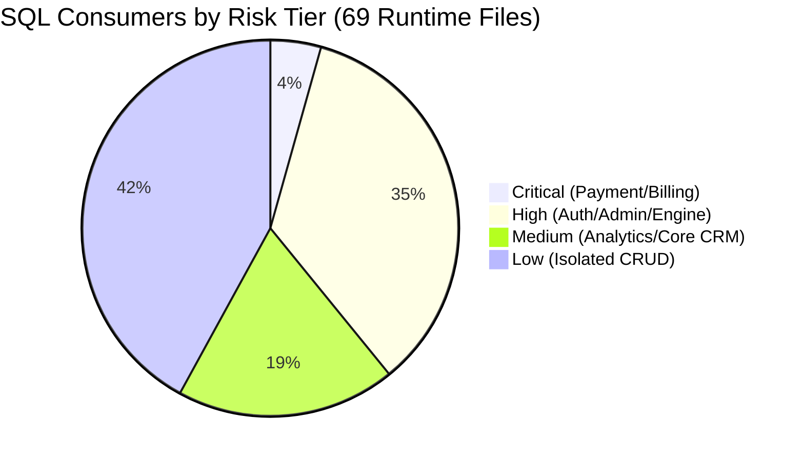

# Resend — Phase P0: Repository & Database Audit

> **Target Audience:** Engineering Team & AI Migration Agents  
> **Repository Root:** `/home/sdev/Projects/Resend`  
> **Phase Branch:** `phase/P0-repository-audit`  
> **Integration Branch:** `integration/prisma-migration`  
> **Audit Completed:** 2026-10-21  
> **Database:** MariaDB `13.0.2-MariaDB` (Database: `whatscrm`)  
> **Runtime:** Node.js `v24.21.0` / npm `11.19.0`

---

## 1. Executive Summary

This audit establishes the baseline inventory, architectural contracts, risk classification, and technical specifications for incrementally migrating the Resend Node.js / Express backend data access layer from raw SQL (`mysql2` connection pool + `dbpromise.js`) to Prisma ORM without altering database schema, mutating production data, or disrupting live business operations.

### Key Audit Findings
1. **Database Surface:** The live MariaDB database (`whatscrm`) contains **78 base tables**.
2. **Referential Integrity Architecture:** Only **2 physical FOREIGN KEY constraints** exist in the entire database (`plan_prices.plan_id -> plan.id` and `support_messages.ticket_id -> support_tickets.id`). The remaining 76 tables rely entirely on **logical/implicit relationships** (e.g. `uid` referencing `user.uid`, `phonebook_id` referencing `phonebook.id`).
3. **Primary Key Patterns:** 75 tables use standard auto-increment integer `id` primary keys. 1 table (`processed_webhook_events`) uses a string `VARCHAR(255)` primary key (`event_id`). 2 tables (`auth` and `undefined`) have no formal `PRIMARY KEY` but possess a unique composite index on `(session, id)`.
4. **Application SQL Footprint:** Out of 125 JavaScript/MJS files in `backend/`, **69 runtime files** issue SQL queries. An additional **16 test and benchmark scripts** interact with the database.
5. **Critical Risk Areas Identified:** Financial and billing persistence in `routes/billing.js`, `helper/razorpay.js`, and legacy payment routes in `routes/user.js` (Stripe, PayPal, MercadoPago) represent the highest risk tier and must be isolated until Phase P5.
6. **Transaction Anomaly in Legacy Code:** In `backend/routes/broadcast.js`, `START TRANSACTION`, `COMMIT`, and `ROLLBACK` are dispatched through `dbpromise.query()`, which borrows and releases connections from the pool on each statement. This exposes transaction statements to cross-connection execution. Migrating to Prisma's interactive `$transaction(async (tx) => ...)` will eliminate this architectural flaw.
7. **Runtime Compatibility:** The host environment runs Node.js `v24.21.0`. **Prisma `^7.10.1`** natively targets Node `^20.19 || ^22.12 || >=24.0` and fully supports MySQL/MariaDB via the `mysql` provider with `relationMode = "prisma"`.

---

## 2. Environment & Dependency Specifications

### 2.1 Verified Runtime & Tooling
| Component | Detected Version | Target / Compatibility Notes |
|---|---|---|
| **Node.js** | `v24.21.0` | Node 24 runtime; requires Prisma 6.x or 7.x |
| **npm** | `11.19.0` | Default package manager for lockfile operations |
| **MariaDB Server** | `13.0.2-MariaDB` | MariaDB server (client 15.2 for Linux x86_64) |
| **Backend Framework** | `express@^4.17.2` | REST API layer |
| **Current DB Driver** | `mysql2@^3.9.2` | Pool-based raw SQL driver (`connectionLimit: 200`) |
| **Frontend Framework** | `next@16.3.5` (Turbopack) | React 19, TypeScript 5.9, TailwindCSS v4 |

### 2.2 Recommended Prisma Version & Connector Setup
- **Recommended Prisma Package:** `prisma@^7.10.1` and `@prisma/client@^7.10.1`.
  - *Engine Constraint:* Verified against npm registry: `{ node: '^20.19 || ^22.12 || >=24.0' }`.
  - *Alternative:* `prisma@^6.19.3` (`{ node: '>=18.18' }`).
- **Datasource Provider:** `provider = "mysql"`.
- **Referential Mode:** `relationMode = "prisma"`.
  - *Rationale:* Since 76 of 78 tables do not have database-level foreign key constraints, setting `relationMode = "prisma"` instructs Prisma to emulate relations in the client layer without expecting foreign key DDL constraints or attempting to create them.
- **Connection URL Format:**
  ```env
  DATABASE_URL="mysql://${DBUSER}:${DBPASS}@${DBHOST}:${DBPORT}/${DBNAME}?connection_limit=20&pool_timeout=10"
  ```
- **Lifecycle Architecture:**
  - Client singleton in `backend/database/prisma.js` (or `backend/lib/prisma.js`).
  - Strict preservation of `backend/database/dbpromise.js` until all consumers are systematically migrated in Phase P6.

---

## 3. Existing Database Architecture & Query Helpers

### 3.1 Connection Pool (`backend/database/config.js`)
```javascript
const mysql = require("mysql2");
const con = mysql.createPool({
  connectionLimit: 200,
  host: process.env.DBHOST || "localhost",
  port: process.env.DBPORT || 3306,
  user: process.env.DBUSER,
  password: process.env.DBPASS,
  database: process.env.DBNAME,
  charset: "utf8mb4",
  waitForConnections: true,
  queueLimit: 0,
  enableKeepAlive: true,
  keepAliveInitialDelay: 10000,
});
```

### 3.2 Shared Query Helper (`backend/database/dbpromise.js`)
```javascript
const con = require("./config");
function query(sql, arr) {
  return new Promise((resolve, reject) => {
    if (!sql) return reject(new Error("No SQL query provided"));
    const params = arr || [];
    con.query(sql, params, (err, result) => {
      if (err) {
        console.error("Query error:", err);
        return reject(err);
      }
      return resolve(result);
    });
  });
}
module.exports = { query };
```

---

## 4. Complete Inventory of Database Tables (78 Tables)

The 78 tables in the live database partition logically into 10 functional subsystems:

### 4.1 Subsystem Classification & Table Inventory

| Subsystem | Table Name | PK Column | PK Type | Row Estimate | Notes & Key Fields |
|---|---|---|---|---|---|
| **Core Tenant & Identity** | `user` | `id` | INT AUTO_INCREMENT | 1,200+ | Master tenant table (`uid`, `email`, `password`, `plan`, `subscription_id`, `subscription_status`, `trial`, `email_verified_at`, `terms_accepted_at`, `google_id`, `is_blocked`) |
| | `admin` | `id` | INT AUTO_INCREMENT | 1 | Root super-administrators (`email`, `password`) |
| | `agents` | `id` | INT AUTO_INCREMENT | ~50 | Multi-agent team members (`uid`, `email`, `role`, `status`) |
| | `agent_chats` | `id` | INT AUTO_INCREMENT | ~100 | Chat assignments to agents |
| | `agent_task` | `id` | INT AUTO_INCREMENT | ~10 | Agent task queues |
| | `email_verification` | `id` | INT AUTO_INCREMENT | ~500 | Secure OTP tokens (`uid`, `email`, `token_hash`, `expires_at`, `used_at`) |
| | `g_auth` | `id` | INT AUTO_INCREMENT | ~5 | Google 2FA credentials |
| | `fcm_tokens` | `id` | INT AUTO_INCREMENT | ~50 | Push notification device tokens (`uid`, `token`) |
| | `admin_audit_logs` | `id` | INT AUTO_INCREMENT | ~200 | Administrator mutation audit trail (`admin_uid`, `action`, `details` JSON/longtext) |
| | `in_app_notifications` | `id` | INT AUTO_INCREMENT | ~300 | User dashboard notifications (`uid`, `title`, `message`, `is_read`) |
| **WhatsApp & Messaging Core** | `instance` | `id` | INT AUTO_INCREMENT | ~150 | WhatsApp QR / Baileys sessions (`uid`, `session_id`, `status`, `phone`) |
| | `meta_api` | `id` | INT AUTO_INCREMENT | ~50 | Meta Official Cloud API credentials (`uid`, `phone_id`, `waba_id`, `access_token`) |
| | `chats` | `id` | INT AUTO_INCREMENT | 10,000+ | Historical and active message logs (`uid`, `sender`, `message`, `type`, `status`) |
| | `beta_chats` | `id` | INT AUTO_INCREMENT | 15,000+ | Real-time chat threads |
| | `beta_conversation` | `id` | INT AUTO_INCREMENT | 5,000+ | Conversation metadata and unread counts |
| | `rooms` | `id` | INT AUTO_INCREMENT | ~20 | Socket room tracking |
| | `chat_tags` | `id` | INT AUTO_INCREMENT | ~100 | Conversation tags and labels |
| | `chat_widget` | `id` | INT AUTO_INCREMENT | ~10 | Embeddable website chat widget configs |
| | `quick_reply` | `id` | INT AUTO_INCREMENT | ~150 | Canned quick replies (`uid`, `msg`) |
| | `meta_templet_media` | `id` | INT AUTO_INCREMENT | ~200 | Meta template media attachments |
| | `templets` | `id` | INT AUTO_INCREMENT | ~150 | Legacy user message templates (`uid`, `title`, `type`, `content`) |
| | `auth` | `(session, id)` | Composite Unique | ~5,000 | Baileys multi-file auth session keys |
| | `undefined` | `(session, id)` | Composite Unique | 0 | Legacy Baileys table artifact when table name was undefined |
| **Contacts & Audience** | `contact` | `id` | INT AUTO_INCREMENT | 50,000+ | Customer contacts CRM (`uid`, `name`, `mobile`, `phonebook_id`, `var1`-`var5`, `createdAt`) |
| | `phonebook` | `id` | INT AUTO_INCREMENT | ~500 | Contact groups / phonebooks (`uid`, `name`) |
| | `wa_contacts` | `id` | INT AUTO_INCREMENT | ~1,000 | Synced device WhatsApp contacts |
| | `contact_form` | `id` | INT AUTO_INCREMENT | ~50 | Inbound lead forms |
| **Campaigns & Broadcasts** | `broadcast` | `id` | INT AUTO_INCREMENT | ~500 | Broadcast campaigns (`uid`, `title`, `template_id`, `phonebook_id`, `status`) |
| | `broadcast_log` | `id` | INT AUTO_INCREMENT | 25,000+ | Per-recipient dispatch status logs |
| | `beta_campaign` | `id` | INT AUTO_INCREMENT | ~200 | Advanced campaign builder campaigns |
| | `beta_campaign_logs` | `id` | INT AUTO_INCREMENT | 10,000+ | Advanced campaign dispatch logs |
| | `qr_campaigns` | `id` | INT AUTO_INCREMENT | ~100 | QR-based broadcast campaigns |
| | `qr_campaign_logs` | `id` | INT AUTO_INCREMENT | 5,000+ | QR campaign message delivery logs |
| | `notification_broadcast_history` | `id` | INT AUTO_INCREMENT | ~50 | Admin-initiated platform notifications |
| **Chatbots, Flows & Automation** | `chatbot` | `id` | INT AUTO_INCREMENT | ~200 | Keyword auto-responders (`uid`, `keyword`, `reply`) |
| | `beta_chatbot` | `id` | INT AUTO_INCREMENT | ~100 | Rule-based chatbot trees |
| | `flow` | `id` | INT AUTO_INCREMENT | ~150 | Visual interactive flow definitions |
| | `beta_flows` | `id` | INT AUTO_INCREMENT | ~100 | Flow builder nodes and connections |
| | `flow_data` | `id` | INT AUTO_INCREMENT | ~500 | Execution node states |
| | `flow_session` | `id` | INT AUTO_INCREMENT | ~2,000 | Live flow user session contexts |
| | `flow_templates` | `id` | INT AUTO_INCREMENT | ~30 | Ready-made flow templates |
| **Public API & Webhooks** | `api_keys` | `id` | INT AUTO_INCREMENT | ~100 | Developer API keys (`uid`, `key_prefix`, `key_hash`, `scopes`, `status`, `expires_at`) |
| | `api_key_connections` | `id` | INT AUTO_INCREMENT | ~150 | Key-to-connection whitelist |
| | `api_connections` | `id` | INT AUTO_INCREMENT | ~150 | Public stable connection aliases (`public_id`, `uid`, `provider`, `provider_ref`) |
| | `api_idempotency_keys` | `id` | INT AUTO_INCREMENT | ~5,000 | Idempotency protection records (`uid`, `idempotency_key`, `response_body`) |
| | `api_rate_limits` | `id` | INT AUTO_INCREMENT | ~500 | Multi-process sliding-window rate limit counters |
| | `api_usage_events` | `id` | BIGINT AUTO_INCREMENT | 50,000+ | Metered developer API call logs |
| | `beta_api_logs` | `id` | INT AUTO_INCREMENT | 10,000+ | Public REST API request/response logs |
| | `webhooks` | `id` | INT AUTO_INCREMENT | ~100 | User-configured outbound webhook endpoints |
| | `webhook_logs` | `id` | INT AUTO_INCREMENT | 15,000+ | Outbound webhook dispatch logs |
| | `processed_webhook_events` | `event_id` | VARCHAR(255) | ~500 | Razorpay webhook idempotency records (`provider`, `event_type`, `payload`) |
| **Subscriptions, Billing & Orders** | `plan` | `id` | INT AUTO_INCREMENT | 5 | SaaS subscription plans (`title`, `price`, `is_trial`, `plan_duration_in_days`, `is_active`) |
| | `plan_prices` | `id` | INT AUTO_INCREMENT | 25 | Multi-currency plan prices (`plan_id`, `currency_code`, `amount`, `billing_period_days`) |
| | `orders` | `id` | INT AUTO_INCREMENT | 2,500+ | Financial order records (`uid`, `order_id`, `amount`, `status`, `payment_gateway`) |
| | `coupon` | `id` | INT AUTO_INCREMENT | 10 | Discount promo codes (`code`, `type`, `value`, `is_active`, `expires_at`) |
| **Social & Omnichannel** | `instagram_accounts` | `id` | INT AUTO_INCREMENT | ~20 | Instagram Direct messaging accounts |
| | `messenger_accounts` | `id` | INT AUTO_INCREMENT | ~20 | Facebook Messenger accounts |
| | `telegram_session` | `id` | INT AUTO_INCREMENT | ~30 | Telegram bot and client sessions |
| **WhatsApp Voice & Forms** | `wa_call_bot` | `id` | INT AUTO_INCREMENT | ~10 | WhatsApp audio call interactive bots |
| | `wa_call_broadcasts` | `id` | INT AUTO_INCREMENT | ~20 | Automated voice call campaigns |
| | `wa_call_flows` | `id` | INT AUTO_INCREMENT | ~20 | Voice IVR logic flows |
| | `wa_call_logs` | `id` | INT AUTO_INCREMENT | ~500 | Call connection duration and status logs |
| | `wa_forms` | `id` | INT AUTO_INCREMENT | ~30 | Interactive WhatsApp in-chat form builders |
| | `wa_form_submissions` | `id` | INT AUTO_INCREMENT | ~500 | Customer submitted form responses |
| **System, Config & Warmers** | `web_public` | `id` | INT AUTO_INCREMENT | 1 | Public app configuration (`app_name`, `google_client_id`, `currency`, `logo`) |
| | `web_private` | `id` | INT AUTO_INCREMENT | 1 | Private credentials (`rz_key`, `rz_id`, `rz_webhook_secret`, `google_client_secret`) |
| | `mail_templates` | `id` | INT AUTO_INCREMENT | 10 | Transactional email HTML templates (`name`, `subject`, `body`) |
| | `smtp` | `id` | INT AUTO_INCREMENT | ~5 | Outbound SMTP mail server configurations |
| | `page` | `id` | INT AUTO_INCREMENT | ~15 | CMS pages (`title`, `slug`, `content`) |
| | `faq` | `id` | INT AUTO_INCREMENT | ~20 | Frequently Asked Questions items |
| | `testimonial` | `id` | INT AUTO_INCREMENT | ~10 | Customer reviews and social proof |
| | `partners` | `id` | INT AUTO_INCREMENT | ~10 | Partner integrations directory |
| | `gen_links` | `id` | INT AUTO_INCREMENT | ~100 | Click-to-chat shortlinks generator |
| | `mobile_app` | `id` | INT AUTO_INCREMENT | ~5 | Mobile app build settings |
| | `warmers` | `id` | INT AUTO_INCREMENT | ~50 | WhatsApp phone number warming tasks |
| | `warmer_script` | `id` | INT AUTO_INCREMENT | ~20 | Warmer conversation simulation scripts |
| | `support_tickets` | `id` | INT AUTO_INCREMENT | ~300 | Customer support tickets (`uid`, `subject`, `status`, `priority`) |
| | `support_messages` | `id` | INT AUTO_INCREMENT | ~1,500 | Threaded support ticket replies (`ticket_id`, `sender_uid`, `message`) |

### 4.2 Explicit Foreign Key Constraints (2 in Database)
1. **`plan_prices.plan_id` -> `plan.id`** (`CONSTRAINT fk_plan_prices_plan FOREIGN KEY (plan_id) REFERENCES plan (id)`)
2. **`support_messages.ticket_id` -> `support_tickets.id`** (`CONSTRAINT fk_support_ticket FOREIGN KEY (ticket_id) REFERENCES support_tickets (id)`)

### 4.3 Special Column Types & MariaDB Dialect Behaviors
- **JSON Columns:** MariaDB `13.0.2` represents declared JSON columns as `LONGTEXT` internally (e.g. `admin_audit_logs.details`, `notification_broadcast_history.details`). In Prisma schema, these should be mapped as `Json` or `String @db.LongText`.
- **ENUM Columns:** 8 columns utilize explicit MySQL ENUMs:
  - `api_connections.provider`: `ENUM('qr', 'meta')`
  - `api_keys.status`: `ENUM('active', 'revoked', 'expired')`
  - `coupon.type`: `ENUM('percentage', 'fixed')`
  - `wa_call_broadcasts.status`: `ENUM('draft', 'requesting_permissions', 'ready', 'running', 'paused', 'completed', 'failed')`
  - `wa_call_logs.status`: `ENUM('connected', 'ended', 'failed')`
  - `webhooks.method`: `ENUM('GET', 'POST', 'PUT', 'DELETE')`
  - `webhook_logs.method`: `ENUM('GET', 'POST', 'PUT', 'DELETE')`
  - `webhook_logs.status`: `ENUM('RECEIVED', 'FAILED')`
- **Case Inconsistencies:** Table `contact` defines camelCase `createdAt TIMESTAMP NOT NULL DEFAULT CURRENT_TIMESTAMP` whereas other tables define `created_at`. Field mapping (`@map("createdAt")`) is mandatory.

---

## 5. Inventory of SQL-Consuming Files by Risk Classification

Across the backend codebase, 69 runtime application files issue raw SQL. They are classified below into 4 distinct risk tiers based on business criticality, financial risk, concurrency, and complexity.



### 5.1 CRITICAL RISK — Payment, Billing & Webhook Persistence (3 Files)
*Strictly deferred to Phase P5. No alterations permitted in earlier phases.*

| File Path | Tables Queried | Key Operations & Invariants |
|---|---|---|
| `backend/routes/billing.js` | `orders`, `plan`, `plan_prices`, `coupon`, `processed_webhook_events`, `user`, `flow` | Razorpay order creation (`create_order`), payment verification (`verify_payment` with HMAC-SHA256 signature check), 14-day free trial activation (`activate_trial` with replay prevention), Razorpay webhook processing with `processed_webhook_events` deduplication, subscription status queries (`GET /subscription`), coupon code validation (`apply_coupon`). |
| `backend/helper/razorpay.js` | `orders`, `plan`, `web_private` | Razorpay instance initialization with keys from `web_private`, order persistence, and status tracking. |
| `backend/routes/user.js` *(Payment Subsystems)* | `orders`, `plan`, `web_private`, `user` | Legacy payment gateways embedded in user router: Stripe checkout sessions (`/create_stripe_session`, `/stripe_payment`), PayPal capture (`/pay_with_paypal`), and MercadoPago preferences and webhooks (`/create_mercadopago_preference`, `/mercadopago_webhook`, `/mercadopago_payment`). |

### 5.2 HIGH RISK — Authentication, Authorization, Public API & Core Engines (24 Files)
*Migrated in Phase P3 (User/Admin) or deferred to specialized engine phases.*

| File Path | Category | Tables Queried | Technical Rationale & Concurrency |
|---|---|---|---|
| `backend/middlewares/user.js` | Auth Middleware | `user`, `contact` | Validates JWT, enforces `email_verified_at`, blocks suspended users (`is_blocked`), binds `req.decode`. |
| `backend/middlewares/admin.js` | Auth Middleware | `admin` | Super-admin JWT verification and privilege boundary. |
| `backend/middlewares/plan.js` | Entitlement Middleware | `plan`, `user`, `instance`, `contact`, `chatbot`, `flow`, `wa_forms` | Checks plan quotas and feature toggles before mutation routes. |
| `backend/middlewares/publicApiAuth.js` | API Auth | `api_keys`, `user`, `plan` | SHA-256 key hash lookup, status check (`active`), scope verification. |
| `backend/middlewares/rateLimiter.js` | Rate Limiter | `api_rate_limits`, `api_usage_events`, `auth`, `contact`, `plan` | High-concurrency sliding-window rate limit counters with atomic increments. |
| `backend/middlewares/idempotency.js` | Idempotency | `api_idempotency_keys` | Replay protection for external REST mutations. |
| `backend/routes/admin.js` | Admin Operations | 40+ tables | Super-admin login, global site settings, user blocking, plan configuration, audit logging, and `safelyDeleteUserTenantData` bulk transaction. |
| `backend/routes/user.js` *(Core User Flow)* | User Lifecycle | `user`, `email_verification`, `g_auth`, `in_app_notifications`, `instance`, `web_public` | Registration with Turnstile, password hashing, Google OAuth linking, login verification, password reset tokens, profile settings. |
| `backend/services/api/apiKeyService.js` | API Service | `api_keys`, `api_key_connections`, `user` | API key generation, hash storage, key revocation. |
| `backend/routes/broadcast.js` | WhatsApp Engine | `broadcast`, `broadcast_log`, `contact`, `meta_api`, `page`, `phonebook`, `plan`, `user` | High-volume message broadcasting, campaign state management, contains legacy `START TRANSACTION` calls. |
| `backend/routes/qr.js` | WhatsApp Engine | `instance`, `user`, `contact`, `wa_contacts`, `phonebook`, `plan` | Baileys QR instance creation, connection handshake, disconnect cleanup. |
| `backend/routes/qrCampaign.js` | WhatsApp Engine | `qr_campaigns`, `qr_campaign_logs`, `instance`, `contact`, `phonebook`, `plan`, `user` | QR campaign queue dispatching. |
| `backend/routes/v1/messages.js` | Public API | `api_usage_events`, `beta_api_logs`, `instance`, `meta_api` | Outbound message dispatch via Meta Cloud API / QR provider. |
| `backend/socket.js` | Realtime Events | `instance`, `rooms`, `agents`, `auth`, `user` | Socket.IO connection authentication, active room tracking. |
| `backend/helper/addon/qr/index.js` | Engine Worker | `instance`, `user`, `auth` | Baileys socket lifecycle, QR pairing state, reconnection loop. |
| `backend/helper/addon/qr/processThings.js` | Engine Worker | `chats`, `contact`, `instance`, `user` | Inbound message processing, contact auto-discovery. |
| `backend/loops/loop.js` | Background Loop | `broadcast`, `broadcast_log`, `instance`, `meta_api` | Cron worker polling scheduled broadcasts. |
| `backend/loops/qrCampaignLoop.js` | Background Loop | `qr_campaigns`, `qr_campaign_logs`, `instance` | Cron worker polling scheduled QR campaigns. |
| `backend/loops/warmerLoop.js` | Background Loop | `warmers`, `warmer_script`, `instance` | Periodic phone number warmup execution loop. |
| `backend/helper/socket/index.js` | Realtime Helpers | `rooms`, `user`, `agents` | Real-time chat socket room event broadcasters. |
| `backend/helper/googleAuth.js` | Security Helper | `user`, `web_private`, `web_public` | Cryptographic Google token verification. |
| `backend/utils/turnstile.js` | Security Helper | `web_private` | Cloudflare Turnstile token validation helper. |
| `backend/services/messaging/publicMessageService.js` | Messaging Service | `beta_api_logs`, `beta_conversation` | Core message dispatch orchestration. |
| `backend/services/connections/connectionService.js` | Connections Service | `api_connections`, `api_key_connections`, `instance`, `meta_api` | Maps stable connection IDs to provider instances. |

### 5.3 MEDIUM RISK — Analytics, Reporting & Core CRM (13 Files)
*Migrated in Phase P4 (Analytics) or carefully staged.*

| File Path | Category | Tables Queried | Technical Rationale & Query Patterns |
|---|---|---|---|
| `backend/services/analytics/analyticsService.js` | Analytics | 15 tables | 29 aggregate queries (`COUNT`, `SUM`, `DATE_FORMAT`), time-series growth, revenue aggregations, message throughput. |
| `backend/services/api/usageService.js` | Analytics | `api_usage_events`, `beta_api_logs` | Endpoint usage rollups, response latency metrics, hourly/daily bucketing. |
| `backend/routes/inbox.js` | CRM Messaging | `chats`, `contact`, `beta_chats`, `beta_conversation`, `instance`, `meta_api` | Multi-agent inbox queries, message threading, unread badge aggregation. |
| `backend/routes/phonebook.js` | CRM Contacts | `phonebook`, `contact`, `user` | Phonebook listing with contact count aggregates (`LEFT JOIN contact ... GROUP BY phonebook.id`). |
| `backend/routes/support.js` | Ticketing | `support_tickets`, `support_messages`, `in_app_notifications`, `admin`, `user` | Customer ticket creation, message threading, status updates. |
| `backend/helper/pricing.js` | Pricing Engine | `plan`, `plan_prices`, `coupon`, `web_public` | Multi-currency price resolution, coupon deduction calculations. |
| `backend/routes/chatFlow.js` | Flow Engine | `flow`, `flow_session`, `chats`, `beta_flows` | Interactive visual flow traversal and session state mutation. |
| `backend/routes/chatbot.js` | Bot Engine | `chatbot`, `beta_chatbot`, `flow`, `user` | Keyword matching, regex matching, automated response retrieval. |
| `backend/routes/v1/contacts.js` | Public API | `contact` | Paginated contact querying with search filtering (`name LIKE ? OR mobile LIKE ?`). |
| `backend/routes/v1/templates.js` | Public API | `templets`, `meta_api` | Template retrieval and sync for public API consumers. |
| `backend/helper/chatbot/meta/index.js` | Bot Engine | `chatbot`, `flow`, `flow_data`, `chats`, `contact` | Meta Cloud API webhook chatbot trigger handler. |
| `backend/helper/chatbot/meta/function.js` | Bot Engine | `chats`, `instance`, `meta_api` | Chatbot execution step handlers. |
| `backend/helper/inbox/chatbot.js` | Bot Engine | `chatbot`, `chats` | Canned chatbot response dispatcher for inbox. |

### 5.4 LOW RISK — Isolated Content & Auxiliary CRUD (29 Files)
*Candidates for Phase P2 (POC) and Phase P3 (CRUD).*

| File Path | Category | Tables Queried | Candidate Evaluation |
|---|---|---|---|
| `backend/routes/templet.js` | **Phase P2 POC Candidate** | `templets` | 57 lines of code; 3 basic endpoints (`POST /add_new`, `GET /get_templets`, `POST /del_templets`). Standalone, zero financial side effects, simple table structure. |
| `backend/routes/quick_reply.js` *(embedded in user/agent)* | Auxiliary CRUD | `quick_reply` | 3 endpoints (`add_quick_reply`, `get_all_quick_reply`, `delete_quick_reply`). Isolated CRUD. |
| `backend/routes/agent.js` | Admin/User CRUD | `agents`, `agent_chats`, `agent_task` | Agent invitations, listing, status toggle, task CRUD. |
| `backend/routes/ai.js` | Content CRUD | `user` | AI assistant configuration and prompt persistence. |
| `backend/routes/kaban.js` | Kanban CRUD | `chat_tags`, `chats` | Conversation Kanban pipeline tag assignments. |
| `backend/routes/waform.js` | Form Builder CRUD | `wa_forms`, `wa_form_submissions` | WhatsApp form schema creation and submission viewing. |
| `backend/routes/waCall.js` | Call Bot CRUD | `wa_call_bot`, `wa_call_flows`, `wa_call_logs` | IVR call configuration CRUD. |
| `backend/routes/web.js` | Public CMS CRUD | `web_public`, `web_private`, `contact_form`, `gen_links`, `page` | Public landing page data, contact form submission, shortlink generator. |
| `backend/routes/apiv2.js` | Legacy API | `beta_api_logs`, `meta_api` | Legacy endpoint wrapper. |
| `backend/routes/insta.js` | Instagram CRUD | `instagram_accounts`, `beta_chats` | Instagram account linking. |
| `backend/routes/messenger.js` | Messenger CRUD | `messenger_accounts`, `webhooks` | Facebook Messenger account linking. |
| `backend/routes/telegram.js` | Telegram CRUD | `telegram_session`, `chats` | Telegram bot credentials. |
| `backend/automation/automation.js` | Automation CRUD | `flow`, `flow_session` | Flow trigger evaluation. |
| `backend/automation/functions.js` | Automation Helpers | 15 tables | Automation step execution helpers. |
| `backend/functions/function.js` | Shared Helpers | 20 tables | Common utility functions and legacy wrappers. |
| `backend/helper/entitlements.js` | Logic Helper | `plan`, `user` | Reads in-memory plan permissions (low SQL). |
| `backend/helper/inbox/inbox.js` | Inbox Helpers | `agents`, `beta_chats`, `flow` | Realtime inbox event formatting. |
| `backend/helper/inbox/messenger/index.js` | Channel Helper | `messenger_accounts`, `beta_chats` | Messenger webhook processing. |
| `backend/helper/inbox/meta/index.js` | Channel Helper | `meta_api`, `contact` | Meta Cloud API message formatting. |
| `backend/helper/addon/embed/index.js` | Channel Helper | `webhooks`, `auth` | Embedded widget socket handshake. |
| `backend/helper/addon/insta/insta.js` | Channel Helper | `admin` | Instagram graph API setup. |
| `backend/helper/addon/insta/processInstagram.js`| Channel Helper | `instagram_accounts`, `beta_chats` | Instagram DM parser. |
| `backend/helper/addon/telegram/tele.js` | Channel Helper | `telegram_session`, `chats` | Telegram MTProto client manager. |
| `backend/helper/addon/telegram/processTelegramInbox.js` | Channel Helper | `telegram_session`, `beta_chats` | Telegram inbound message parser. |
| `backend/helper/addon/wacall/wacall.js` | Voice Helper | `wa_call_bot`, `wa_call_flows` | Voice call session loop. |
| `backend/helper/addon/wacall/functionRegistry.js` | Voice Helper | `smtp`, `user` | IVR webhook trigger registry. |
| `backend/helper/addon/web-notification/webPush.js` | Notification Helper | `fcm_tokens`, `beta_chats` | Web push notification dispatcher. |
| `backend/routes/v1/health.js` | Health Check | None | Stateless public API health check. |
| `backend/routes/v1/openapi.js` | Documentation | None | Serves OpenAPI specification. |

---

## 6. Baseline Verification Checks & Test Execution Results

All commands were executed directly against the local repository and recorded without mocking:

| Test Suite / Command | Working Directory | Command Executed | Recorded Result | Passing Details |
|---|---|---|---|---|
| **TypeScript Typecheck** | `frontend/` | `npm run typecheck` | **0 Errors** (Clean pass) | `tsc --noEmit` compiled all 65 frontend routes with 0 type errors. |
| **ESLint Static Analysis** | `frontend/` | `npm run lint` | **0 Errors** (23 warnings) | Clean pass with zero errors. All 23 warnings are preexisting unused variables. |
| **Next.js Production Build** | `frontend/` | `npm run build` | **65/65 Routes Compiled** | TurboPack production build succeeded in 1.28s; all static and dynamic pages verified. |
| **Signup & Security Suite** | `backend/` | `node test-signup-audit-acceptance.mjs` | **16/16 Passed** | Form validation, password rules, DPDP consent, Turnstile verification, DB persistence. |
| **Google Auth Suite** | `backend/` | `node test-google-auth-acceptance.mjs` | **24/24 Passed** | Secret isolation, JWT session generation, account linking, trial assignment. |
| **Turnstile & Rate Limit Suite** | `backend/` | `node test-turnstile-acceptance.mjs` | **11/11 Passed** | Cloudflare verify, fail-closed handling, sliding-window rate limit enforcement. |
| **Onboarding & Billing Suite** | `backend/` | `node test-onboarding-billing-acceptance.mjs` | **11/11 Passed** | Trial activation, pending order creation, HMAC payment verification, webhook idempotency. |
| **Database Connection Test** | `backend/` | Node `mysql2` ping | **Connected** | MariaDB `13.0.2-MariaDB` connected on `localhost:3306`; verified 78 tables. |

---

## 7. Migration Risks & Technical Mitigation Strategies

| Risk Factor | Impact | Technical Mitigation Strategy |
|---|---|---|
| **Absence of DB Foreign Keys** | Prisma defaults to validating database foreign key constraints. Running schema synchronization or standard relations could fail. | Configure `relationMode = "prisma"` in `schema.prisma`. Prisma will handle cascading deletes and relation integrity at the client level without generating MySQL FOREIGN KEY DDL. |
| **Connection-Lost Transactions in Legacy Code** | Legacy code in `routes/broadcast.js` calls `START TRANSACTION` across independent pooled connections. | In migrated modules, replace raw transaction statements with Prisma interactive transactions: `await prisma.$transaction(async (tx) => { ... })`. |
| **MariaDB JSON Column Handling** | MariaDB represents `JSON` columns as `LONGTEXT` internally. | In `schema.prisma`, annotate JSON columns as `Json` or `String @db.LongText`, and parse using runtime validators (e.g. `zod` or `JSON.parse` guards). |
| **Tables Without Primary Keys** | `auth` and `undefined` do not have formal `PRIMARY KEY` constraints in MariaDB. | Map `auth` in Prisma using `@@unique([session, id])` or `@@id([session, id])`. Exclude the empty artifact table `undefined` from active application Prisma models. |
| **Field & Table Name Irregularities** | Misspelled tables (`templets`, `kaban`) and mixed casing (`createdAt` in `contact` vs `created_at` elsewhere). | Use Prisma `@map("legacy_column")` and `@@map("legacy_table")`. Never alter production column names or database tables. |
| **Financial & Webhook Invariants** | Any change to Razorpay signature validation, idempotency, or order status will cause payment failures or duplicate subscription grants. | Strictly isolate all billing, payment, and order queries to Phase P5. Never modify `routes/billing.js` or `helper/razorpay.js` prior to Phase P5. |
| **Large Router Monoliths** | `routes/user.js` is 4,300+ lines; `routes/admin.js` is 2,200+ lines. Broad refactoring risks collateral regression. | Adopt targeted route-by-route migration during Phase P3. Keep unmigrated route handlers using `query(...)` side-by-side with Prisma handlers. |

---

## 8. Proposed Migration Sequence & Phase Roadmap

Following the project mandates, the migration proceeds strictly sequentially across dedicated branches created from `integration/prisma-migration`:

```text
Phase P0 (Audit)  ──►  Phase P1 (Prisma Foundation)  ──►  Phase P2 (Data-Access POC: templets)
                                                                     │
Phase P5 (Billing)  ◄──  Phase P4 (Analytics)  ◄──  Phase P3 (User & Admin CRUD)
        │
        ▼
Phase P6 (Full Regression, Staging Verification & Rollout)
```

1. **Phase P0 — Repository & Database Audit (Current Branch: `phase/P0-repository-audit`):**
   - Audit completed. Deliverable: `docs/prisma-migration/PHASE_P0_AUDIT.md`.
   - Baseline checks recorded; no application code or schema modified.
2. **Phase P1 — Prisma Foundation (`phase/P1-prisma-foundation`):**
   - Install `prisma@^7.10.1` and `@prisma/client@^7.10.1`.
   - Configure `backend/prisma/schema.prisma` with `provider = "mysql"`, `relationMode = "prisma"`.
   - Run non-destructive introspection (`npx prisma db pull`).
   - Add model `@map` and `@@map` annotations to preserve legacy MariaDB table and column names.
   - Generate client (`npx prisma generate`).
   - Add minimal read-only health verification script (`backend/test-prisma-health.mjs`).
3. **Phase P2 — Data-Access Layer Proof of Concept (`phase/P2-data-access-layer`):**
   - Implement shared singleton Prisma client (`backend/database/prisma.js`).
   - Migrate low-risk module **`backend/routes/templet.js`** (`templets` table: `add_new`, `get_templets`, `del_templets`).
   - Write regression unit tests covering success, empty results, and validation.
   - Verify that unmigrated routes continue functioning via `dbpromise.query`.
4. **Phase P3 — User and Admin CRUD (`phase/P3-user-admin-crud`):**
   - Migrate isolated CRUD routes in `routes/user.js` (quick replies, user profile fields, in-app notifications).
   - Migrate admin entities: plans (`routes/admin.js` plan CRUD), support tickets (`routes/support.js`), audit logs (`admin_audit_logs`).
   - Implement transaction boundaries using `prisma.$transaction`.
5. **Phase P4 — Analytics and Reporting (`phase/P4-analytics`):**
   - Migrate aggregate metrics in `services/analytics/analyticsService.js` and `services/api/usageService.js`.
   - Map complex grouping queries to Prisma `groupBy` / `aggregate` or safe parameterized raw queries (`prisma.$queryRaw`).
   - Verify date boundary, time-series, and currency calculation parity.
6. **Phase P5 — Billing, Payments and Transactions (`phase/P5-billing`):**
   - Migrate `routes/billing.js` and `helper/razorpay.js`.
   - Preserve Razorpay HMAC signature checks, webhook idempotency with `processed_webhook_events`, order creation, and subscription status updates.
   - Run complete payment acceptance suite (`test-onboarding-billing-acceptance.mjs`).
7. **Phase P6 — Full Regression, Rollout & Cleanup (`phase/P6-regression-rollout`):**
   - Run complete regression suite across backend and frontend.
   - Audit remaining occurrences of raw SQL; verify all remaining queries are documented and justified.
   - Staging verification checklist and rollback plan.
   - Deprecate `dbpromise.js` only after 100% of consumers are migrated and verified.

---

## 9. Phase P0 Acceptance Checklist & Verification Gate

- [x] Audit reflects actual repository files and live database state without guesswork.
- [x] All 78 live MariaDB tables identified and categorized into functional subsystems.
- [x] All 69 runtime SQL-consuming files inventoried and classified into risk tiers.
- [x] High-risk billing, payment, and transaction code explicitly identified.
- [x] Baseline typecheck, lint, build, and test checks have real recorded results.
- [x] Node.js `v24.21.0` and MariaDB `13.0.2` compatibility verified.
- [x] Zero packages installed; zero schema or application changes introduced.
- [x] Zero secrets or sensitive database credentials exposed.
- [x] Deliverable `docs/prisma-migration/PHASE_P0_AUDIT.md` completed.
